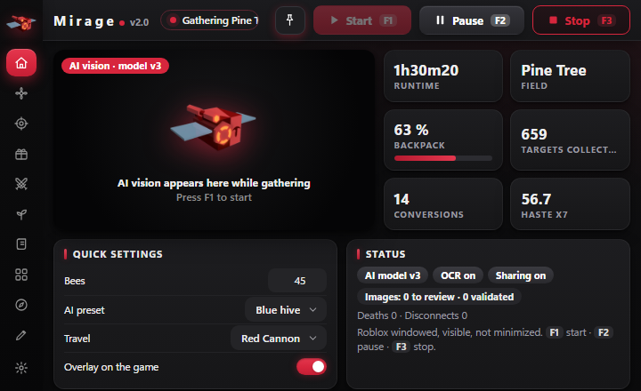
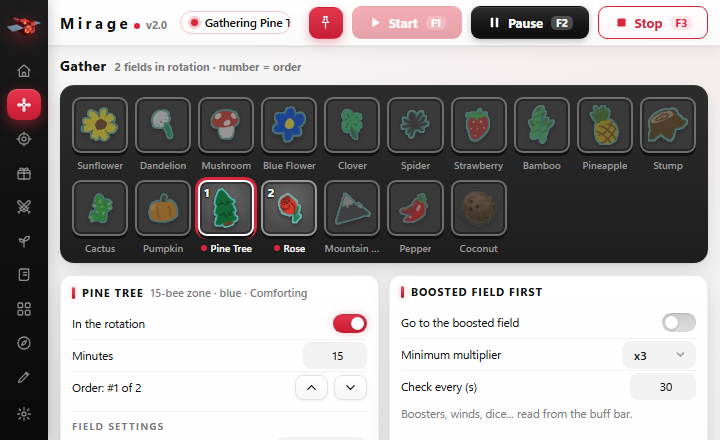
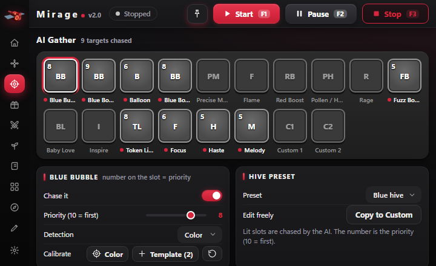
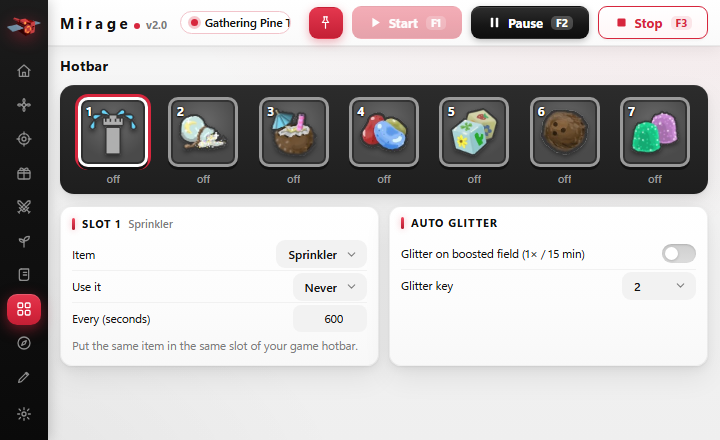
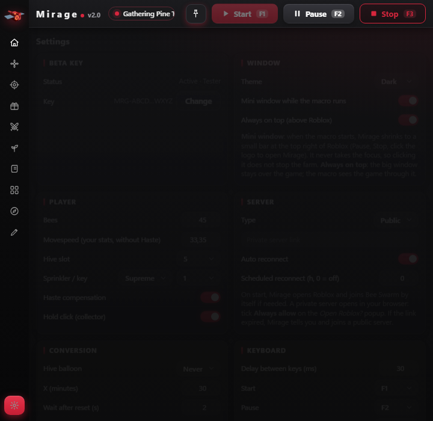

# Mirage — Bee Swarm Simulator macro (beta)

Mirage gathers, converts and runs your tasks in **Bee Swarm Simulator** while you're away.
Its **AI gather** watches the field and goes for bubbles, tokens and balloons instead of walking a fixed pattern.

  
  

  
  

> **Closed beta.** Mirage needs a **beta key** to start. Ask the author for one: one key per tester, tied to one PC.

## Download

1. Open **[Releases](../../releases/latest)** and download `Mirage-<version>.zip`.
2. Extract the whole folder (right click > *Extract All*). Don't run it from inside the zip.
3. Start **`Mirage.exe`** and enter your beta key (`MRG-XXXX-XXXX-XXXX-XXXX`).

Windows may show *"Windows protected your PC"* the first time (the app isn't signed yet):
click **More info** then **Run anyway**.

Updating: extract the new version anywhere. Your settings and key are kept (they live in `%LOCALAPPDATA%\Mirage`).

## Requirements

- Windows 10 or 11 (64-bit)
- Roblox desktop app
- Mirage moves your character with the keyboard: leave Roblox in front while it runs
  (Mirage pauses by itself if another window comes in front)

## What it does

- **Starts from anywhere**: opens Roblox if needed, joins your private server (opens your link in the
  browser; tick *Always allow* on the *Open Roblox?* popup) or a public server, waits for the game, claims a hive
- **AI gather** (bubbles, tokens, balloons, flames, sprinklers) that stays inside the field, even with
  Haste / Bear Morph, and isn't fooled by trees hiding the ground
- **Own fast paths** through the Red Cannon and the glider: 14 fields and the Strawberry Dispenser
- **Gather patterns**: Sweep, Columns, Spiral, Rings, Star, Eight, Wave, Hourglass, Tight, Stationary,
  and **PinePocket** for Pine Tree (inside the big pine, shift lock)
- Field rotation, boosted fields, conversion, planters taken from your inventory
- Discord webhook with screenshots
- **Mini bar** while the macro runs (top right of Roblox, never takes the focus), always-on-top window,
  light and dark themes

  

Coming next: Stump, Pepper and Coconut fields, the other dispensers, boosters and quest givers.

## Your data

- Key check: your key and an anonymous ID of your PC (a hash, never your name or files).
- Field images to improve the AI are sent **only if you accept** (you can turn it off in Settings).

## Settings

## Keys

| Problem | What to do |
|---|---|
| "This key is already used on another PC" | ask the author to reset your key |
| "This key has been disabled" / "expired" | ask the author for a new key |
| "Can't reach the beta server" | check your internet; an already activated key works 48 h offline |

---

Mirage is not affiliated with Roblox or Onett. Use it at your own risk.
© CalifoW — all rights reserved. Do not redistribute, resell or reverse-engineer Mirage.
